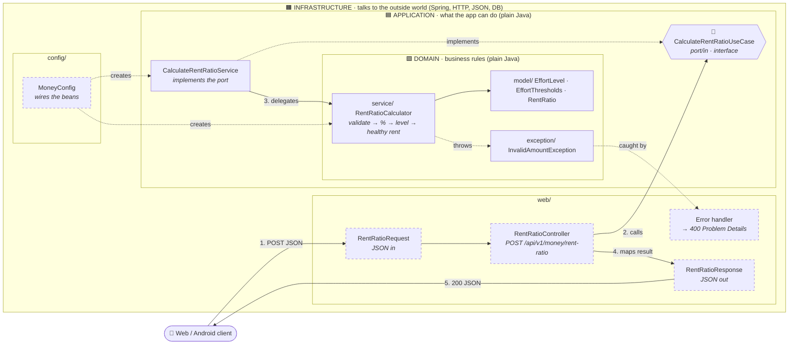

# Money module · Architecture map

> **Status:** temporary. This diagram is generated with Mermaid; it will be replaced by a hand-drawn Excalidraw diagram (`money-module.png`).
> **Scope:** spec [001 · Rent-to-income ratio](../specs/001-rent-ratio/spec.md) · package structure decided in ADR-0002.

## TL;DR
- The `money` module follows **hexagonal architecture**: three layers, one inside the other.
- **Dependencies always point inwards**: `infrastructure → application → domain`. The domain knows nothing about the outside world.
- Only `infrastructure` knows about Spring, HTTP, JSON or the database. `domain` and `application` are plain Java, so they are fast to test and easy to change.

## Diagram

Solid border = implemented ✅ · dashed border = pending 🔜

## Layers

| Layer | Question it answers | May use | Example in Nido |
|---|---|---|---|
| **Domain** | *What are the rules?* | Plain Java only | "30 % or more is amber", "income must be greater than 0" |
| **Application** | *What can the app do?* | Plain Java + the domain | "Calculate the rent ratio" (later: "…and save it to the history") |
| **Infrastructure** | *How do we talk to the outside world?* | Spring, HTTP, JSON, DB | "Receive JSON via POST, return 200 or 400" |

## Legend

### 🟩 Domain · `com.nido.backend.money.domain`

| Package | Class | Kind | Responsibility | Status |
|---|---|---|---|---|
| `model/` | `EffortLevel` | `enum` | The three traffic-light colours: GREEN · AMBER · RED | ✅ |
| `model/` | `EffortThresholds` | `record` | Traffic-light limits (`amberFrom` = 30 %, `redAbove` = 40 %) and `classify(percentage)` | ✅ |
| `model/` | `RentRatio` | `record` | Calculation result: percentage, level, `rentExceedsIncome`, `healthyMaxRent` | ✅ |
| `service/` | `RentRatioCalculator` | `class` | Validates amounts (AC5), computes the percentage (R1), rounds and classifies it (R2), finds the healthy max rent (R4) | ✅ |
| `exception/` | `InvalidAmountException` | unchecked exception | An amount breaks a domain rule: missing, ≤ 0, more than 2 decimals or above 1,000,000. Messages name the field, never the value | ✅ |

### 🟦 Application · `com.nido.backend.money.application`

| Package | Class | Kind | Responsibility | Status |
|---|---|---|---|---|
| `port/in/` | `CalculateRentRatioUseCase` | `interface` | **Input port**: the contract the web layer depends on | ✅ |
| *(root)* | `CalculateRentRatioService` | `class` | Implements the port. Thin on purpose: delegates to the domain. Future home of persistence and auth concerns | ✅ |

### 🟧 Infrastructure · `com.nido.backend.money.infrastructure`

| Package | Class | Kind | Responsibility | Status |
|---|---|---|---|---|
| `web/` | `RentRatioRequest` | `record` (DTO) | Incoming JSON: `netMonthlyIncome`, `rentShare`. Bean Validation in T9 | 🔜 T8 |
| `web/` | `RentRatioResponse` | `record` (DTO) | Outgoing JSON. Maps the domain `RentRatio` to the public API contract | 🔜 T8 |
| `web/` | `RentRatioController` | `@RestController` | HTTP entry point: `POST /api/v1/money/rent-ratio` | 🔜 T8 |
| `web/` | error handler | `@RestControllerAdvice` | Turns validation and domain errors into `400` Problem Details (RFC 9457) | 🔜 T9 |
| `config/` | `MoneyConfig` | `@Configuration` | Creates the beans so `domain` and `application` stay framework-free. Reads thresholds from config in T10 | 🔜 T8 / T10 |

## Request flow

1. The client sends `POST /api/v1/money/rent-ratio` with `{ "netMonthlyIncome": 1500.00, "rentShare": 450.00 }`.
2. Spring maps the JSON to `RentRatioRequest` and the controller calls the **port** (`CalculateRentRatioUseCase`).
3. `CalculateRentRatioService` delegates to `RentRatioCalculator`, which validates, calculates and classifies.
4. The controller maps the domain `RentRatio` to `RentRatioResponse`.
5. The client receives `200 { "percentage": 30.0, "level": "AMBER", "healthyMaxRent": 449, "rentExceedsIncome": false }`.

**Error path:** invalid JSON (T9) or an `InvalidAmountException` → `400` Problem Details, without echoing any amount.

## Tests per layer

| Layer | Test class | Type | Status |
|---|---|---|---|
| Domain | `RentRatioCalculatorTest` | Unit, plain Java (22 tests) | ✅ |
| Application | `CalculateRentRatioServiceTest` | Unit, no Spring (2 tests) | ✅ |
| Infrastructure | `RentRatioControllerTest` | `@WebMvcTest` web slice | 🔜 T8 / T9 |

Many fast tests at the core, few slower ones at the edge: the **test pyramid**.

## Glossary

| Term | Meaning |
|---|---|
| **Port** | An interface through which the outside world enters the application |
| **DTO** | *Data Transfer Object*: the shape of data at the boundary (the JSON), separate from the domain model |
| **Bean** | An object created and managed by Spring |
| **Dependency rule** | Source code dependencies only point inwards; the domain never imports from outer layers |
